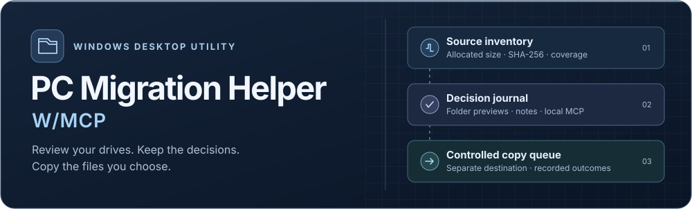

<p align="center">
  
</p>

# PC Migration Helper W/MCP

A Windows desktop app for deciding what to take to a new PC, recording the reasoning, and copying selected files to a separate drive. The local Model Context Protocol (MCP) server lets an agent inspect and navigate the review while you keep control of decisions and copy settings.

<p align="center">
  <a href="#get-started">Get started</a> ·
  <a href="#review-and-copy">Review and copy</a> ·
  <a href="docs/MCP.md">MCP setup</a> ·
  <a href="LICENSE">Project license</a>
</p>

<table>
  <thead>
    <tr><th scope="col">Review</th><th scope="col">Inventory</th><th scope="col">Copy</th></tr>
  </thead>
  <tbody>
    <tr>
      <td>Preview nested folders side by side. Save decisions, child exceptions, and notes as you work.</td>
      <td>Count files and allocated bytes, hash readable source data with SHA-256, and inspect gaps or changes.</td>
      <td>Run the copy queue from the desktop, preserve paths relative to the source drive, and review per-file outcomes.</td>
    </tr>
  </tbody>
</table>

## Get started

Use Windows 10 or 11 with WebView2, Visual Studio C++ Build Tools, a current Rust MSVC toolchain, and Node.js 26. The build uses npm, Tauri, React, and Rust. See the [Tauri Windows prerequisites](https://v2.tauri.app/start/prerequisites/).

From a local checkout, run these in PowerShell.

```powershell
npm ci
npm run tauri -- dev
```

The default source roots are `C:\` and `E:\`. The copy destination is `F:\` on a different volume. A missing drive appears as unavailable. Keep the checkout writable so the app can create its ignored `runtime` directory.

<details>
<summary>Build an executable and try it on disposable folders</summary>

Build a source executable with these commands. With the default Cargo target directory, the executable is `src-tauri\target\release\migration-master.exe`. A custom `CARGO_TARGET_DIR` changes its location.

```powershell
npm run build
cargo build --release --locked --features tauri/custom-protocol --manifest-path src-tauri/Cargo.toml
```

```powershell
$fixture = Join-Path (Get-Location).Path 'runtime\demo'
New-Item -ItemType Directory -Force -Path (Join-Path $fixture 'source'), (Join-Path $fixture 'destination')
Set-Content -LiteralPath (Join-Path $fixture 'source\sample.txt') -Value 'Disposable sample'
& .\src-tauri\target\release\migration-master.exe --fixture-root $fixture
```

The fixture window uses these sibling directories for source and destination. Its journal and runtime data stay under the fixture directory. You can also set `MIGRATION_MASTER_FIXTURE_ONLY=1` before compiling a test build to require a fixture at launch.

</details>

## Review and copy

1. Open a drive and click a folder name to enter it. Use the folder arrow to preview contents in the next column, or use the decision filter to narrow the main listing.
2. Right-click a row or open its **⋯** menu to mark it. Add notes from the decision panel. Folder decisions flow to eligible children, and specific child decisions override them. An unmarked folder can show a derived summary of its children within a 2,000-entry, 64-level inspection budget. The copy queue uses saved decisions.
3. Use **Count & hash** to inspect the current folder or all available source drives. Coverage and the notification bell show inaccessible paths and observed changes.
4. Open the copy queue, check the destination, and start the intended batch. **Copy everything** runs over eligible **Migrate now** marks and can recheck files already on the destination. **Migrate last moment** has a separate per-entry action. **Auto-copy** starts off for each window session. While enabled, it can act on new **Migrate now** marks, including ones you direct an agent to save.

The queue preserves paths below each source root. It blocks destination collisions and refuses to overwrite different content. It copies regular files and empty folders, verifies the unnamed file data stream with SHA-256, and records outcomes. Extra streams, links, offline data, and inaccessible paths can leave explicit gaps. Source files stay in place. **To be ERASED** records review intent.

Closing the window during an active copy requests a pause. Wait for the queue to stop, then close the window.

<details>
<summary>Keyboard controls</summary>

Use <kbd>Tab</kbd> and <kbd>Shift</kbd>+<kbd>Tab</kbd> to move between controls. On a folder row, <kbd>Enter</kbd> opens the folder and <kbd>→</kbd> previews it. In a preview, <kbd>←</kbd> closes that preview and returns to its parent. Use <kbd>↑</kbd> and <kbd>↓</kbd> to move through entries, or press <kbd>↓</kbd> from a column heading to find an entry that needs attention.

<kbd>Space</kbd> and <kbd>Shift</kbd>+<kbd>F10</kbd> open a row’s decision menu. <kbd>Ctrl</kbd>+<kbd>Space</kbd> toggles the row’s selection. Use <kbd>Esc</kbd> to close a menu or dialog. From a row, <kbd>Esc</kbd> goes to search, and from the search toolbar it returns to the drive buttons. <kbd>Ctrl</kbd>+<kbd>Z</kbd> outside an editing field undoes the previous decision or note.

At the end of the search field, <kbd>→</kbd> moves to **Known folders**. Press <kbd>→</kbd> again to open the decision filter. The filter also opens when reached with <kbd>Tab</kbd>. Use the arrow keys and <kbd>Enter</kbd> to choose a filter.

</details>

## Manual backup decisions

**Marked for Manual Backup** records a manual copy that is still pending and can flow to eligible children as intent. **Confirmed Manual Backup** records your explicit assertion for the selected path. Children retain their own review state. An unmarked parent can show a summary when its observed children are individually confirmed. Observed source changes return an affected confirmation to **Needs attention**.

The app records confirmation time, provenance and source metadata. Destination checksum comparison and restore evidence have their own scope. Both manual choices stay outside automated copy batches. Existing **Already on F:** decisions retain their original selected-path behavior.

## AI Assistance and adjustable layout

Open **AI Assistance**, choose the current folder and complete its metadata inventory. The interview presents one question at a time with **Approve**, **Override**, **Review children** and **Defer**. Likely local exceptions are considered before their parents, and uncertain branches default to keeping data. Deferred branches and coverage gaps stay visible. Pending manual backups receive an explicit confirmation question after the ordinary review decisions.

Drag sidebar or folder-column dividers to resize them, or focus a divider and use the arrow keys. An edge warning appears before a sidebar collapses or a column fills the workspace. Reopen controls restore the saved widths and preview branch. **Ctrl+End** on a folder divider fills its pane. Compact toolbar mode keeps labeled **Path** and **Search** controls available. Layout, filter and review context are saved automatically.

## Work with an MCP agent

Register the bundled stdio server with your MCP client and leave the native app open. An agent can read folder metadata, saved decisions, audit progress, and the currently rendered review columns. It can navigate or reveal a path without clearing your filter. **Follow AI’s movement** is a window preference that reveals paths as the agent touches them when the review is idle.

Agent suggestions are stored separately. User-directed changes retain their provenance and use the current app session and journal revision. Starting a copy is a desktop action. See [MCP setup and tool usage](docs/MCP.md).

## Data and coverage

The checkout’s `runtime` directory holds the review journal, recovery copy, inventory, audit and copy receipts, and the private gateway descriptor. Keep the journal in your backup plan. To use another writable location, launch the executable with `--data-dir` and an absolute directory path, then point the MCP server at that directory’s descriptor.

Use `--journal-file` with an existing absolute journal filename to retain a journal stored separately from the runtime directory. Fixture runs use their own journal and reject regular-run journal overrides.

The audit checks readable unnamed file streams. Allocation totals count hard-linked entries individually. Access failures, skipped links, unsupported streams, and unavailable paths can leave coverage gaps. A green **Already on F:** mark records your manual assertion. Copy receipts and source checksums cover the reported files and byte streams. Confirm the files and application state you need by testing a restore before retiring a source drive.

## Development

```powershell
npm run build
npm test
cargo test --locked --manifest-path src-tauri/Cargo.toml
```

The frontend and MCP bridge tests use simulated data. Native tests use isolated temporary folders and exercise Windows file handling, persisted decisions, and guarded copy behavior. The app source is available under the [project license](LICENSE).
